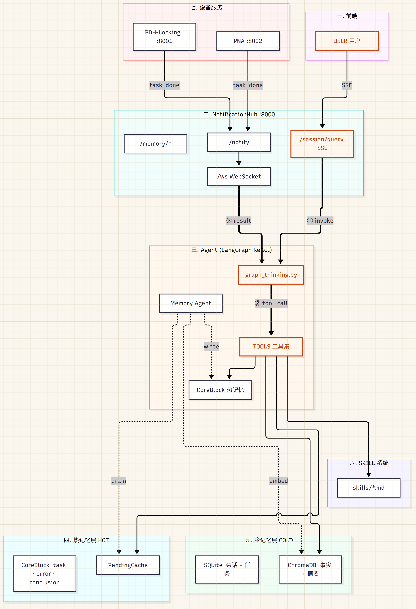

# LabPilot

> 光学实验 Agent 助手 —— 基于 LangGraph 的 ReAct 智能体，通过 FastAPI SSE 流式输出 + Skill 技能系统，驱动 PDH/PNA 等设备完成自动化测量。

支持 **Anthropic 直连** 与 **OpenAI 兼容后端**（通过 LiteLLM Proxy 自动桥接），内置长期记忆 + 三层对话压缩 + 多设备通知。

---

## 核心功能

- **自然语言驱动实验**：用日常语言描述需求，Agent 自动拆解步骤、调度工具、产出结果——不用手写脚本
- **多设备协同**：PDH 腔锁定、PNA 测量等可由同一 Agent 串成完整工作流
- **跨会话记忆**：参数、错误解法、历史结论自动留存，下次同类实验自动召回
- **技能可插拔**：每个领域（光学测量、论文解析、…）可独立写一个 `SKILL.md` 即用
- **流式可观测**：每步思考 + 工具调用 + 结果实时显示，便于调试和复盘
- **输入全可见**：调试开关一开，后端终端直接显示**实际发给模型的那一整套输入**（含工具完整定义）
- **模型无关**：同一套 Agent 可跑在 Claude / DeepSeek / Qwen / Ollama 上，横向对比零代码改动
- **自动压缩会话**：长实验自动摘要，不丢上下文、不爆 token
- **Tauri 桌面 + Vite Dev 双前端**：开发用 Web，部署用桌面，按场景切换

---

## 快速开始（5 步上手）

### 前置（一次性）

1. 装 [uv](https://docs.astral.sh/uv/) 0.4+
2. 装 Node.js 18+（Vite 前端）
3. Windows 装 [VC++ Redistributable](https://aka.ms/vs/17/release/vc_redist.x64.exe)（`sentence-transformers → torch` 需要）
   ```powershell
   winget install --id Microsoft.VCRedist.2015+.x64 -e --source winget
   ```

### 拉新代码后

4. 装依赖：
   ```powershell
   uv sync
   cd frontend; npm install; cd ..
   ```
5. 复制 `.env` 并填 Key：
   ```powershell
   cp .env.example .env
   # 填 ANTHROPIC_API_KEY，或填 OPENAI_API_KEY 走 OpenAI 兼容（见下文）
   ```
6. 启动：
   ```powershell
   .\start-dev.ps1
   ```

> 💡 `start-dev.ps1` 内置 Pre-flight 自检：`.env` 缺失 → 黄字提示；`frontend/node_modules` 缺失 → 询问是否 `npm install`（默认 Y）。

### 启动方式

| 模式 | 命令 | 用途 |
|------|------|------|
| **REPL** | `uv run python -m src.agent.repl` | 纯终端调试，支持 `/compact` `/history` |
| **Dev** | `.\start-dev.ps1` | 后端 8000 + Vite 前端 1420，推荐开发用 |
| **Tauri** | `.\start-tauri.example.ps1` | 桌面应用，需 Rust + MSVC |

手动起后端：`uv run uvicorn src.agent.websocket_server:create_notification_hub_app --factory --host 127.0.0.1 --port 8000`

---

## 模型后端

### Anthropic 直连（默认）

`.env`：
```env
ANTHROPIC_API_KEY=sk-ant-xxxxx
ANTHROPIC_BASE_URL=https://api.anthropic.com   # 自托管/LiteLLM 也填这里
MODEL_ID=claude-sonnet-4-20250514
```

### OpenAI 兼容（LiteLLM Proxy 自动桥接）

`.env` 只设 `OPENAI_API_KEY` 而不设 `ANTHROPIC_API_KEY` 时，LabPilot 启动时自动 spawn 一个本地 LiteLLM Proxy（默认 `127.0.0.1:4000`），把 Anthropic 协议翻译成 OpenAI 兼容协议——业务代码（ReAct / tool_use / auto_compact）一行不动。

**硅基流动 Qwen2.5-14B**：
```env
OPENAI_API_KEY=sk-xxxxxxxx
LITELLM_MODEL=openai/qwen2.5-14b-instruct
LITELLM_MODEL_API_BASE=https://api.siliconflow.cn/v1
LITELLM_MODEL_API_KEY=sk-xxxxxxxx      # 留空复用 OPENAI_API_KEY
```

**本地 Ollama Llama3.1**：
```env
OPENAI_API_KEY=sk-local
LITELLM_MODEL=ollama_chat/llama3.1
LITELLM_MODEL_API_BASE=http://127.0.0.1:11434
```

### 直连 OpenAI（无本地 proxy）

想跳过 LiteLLM Proxy 直接打 OpenAI/兼容端点，设 `LITELLM_AUTOSTART=true` 走 `ChatOpenAI` 路径。

---

## 项目结构

```
LabPilot/
├── src/agent/
│   ├── __init__.py          # graph / TOOLS / SKILLS 导出
│   ├── config.py            # 工作目录、模型、阈值
│   ├── graph.py             # Server 模式图（langgraph.json 入口）
│   ├── graph_thinking.py    # ReAct 图 + SSE 事件发射 + tool_use id 跨 message 去重
│   ├── llm.py               # LLM 初始化（Anthropic / LiteLLM Proxy / ChatOpenAI 三态）
│   ├── prompt_context.py    # 提示词组装（系统提示词 + 核心记忆 + 检索记忆 + 历史，带来源标签）
│   ├── prompt_debug.py      # 调试输出（忠实完整地呈现实际发给模型的输入）
│   ├── tools.py             # 工具集（bash / read / write / edit / subagent / memory / skill / compact）
│   ├── session_manager.py   # 会话存储（SQLite，三层压缩 + partial_json 兜底）
│   ├── websocket_server.py  # NotificationHub（SSE + WebSocket + REST API）
│   ├── state.py             # StateGraph 状态定义
│   ├── repl.py              # REPL 入口
│   └── memory/              # 长期记忆子系统
│       ├── core.py          # CoreBlock 热记忆（task / error / conclusion）
│       ├── archival.py      # 归档导出
│       ├── archival_store.py# ChromaDB 封装
│       ├── pending.py       # 待总结队列（PendingCache）
│       ├── memory_agent.py  # Memory Agent（drain pending → ChromaDB）
│       └── constants.py     # PENDING_THRESHOLD 等
├── instrument/              # 设备微服务
│   └── pna/                 # PNA 相位噪声分析仪（端口 8002）
│       ├── main.py          # FastAPI 入口
│       ├── pna_instrument.py# RsInstrument 封装
│       ├── task_manager.py  # 异步任务管理
│       ├── schemas.py       # pydantic 请求/响应模型
│       └── config.py
├── frontend/                # Tauri 桌面应用（src-tauri/ + src/）
│   └── src/
│       ├── components/      # ChatWindow / MemoryModal / HistoryModal ...
│       ├── hooks/           # useSSE / useSession / useWebSocket
│       └── types/           # TypeScript 类型
├── skills/                  # 技能定义（SKILL.md）
│   ├── pdh-locking/         # PDH 腔锁定
│   ├── pna/                 # PNA 测量
│   ├── paper_reader/        # 论文解析
│   └── skill-builder/       # 写 skill 的元技能
├── data/                    # 运行时数据（gitignored）
│   ├── sessions/            # JSON 会话归档
│   └── memory/              # ChromaDB + SQLite
├── tmp/                     # 临时测试脚本（独立 TDD 验证用）
├── agent_langgraph.py       # 旧入口（保留兼容）
├── langgraph.json           # LangGraph CLI 配置
├── pyproject.toml           # 依赖声明（uv 锁定）
├── requirements.txt         # pip 兼容声明
├── start-dev.ps1            # Dev 模式启动
├── start-tauri.example.ps1  # Tauri 启动（模板）
└── README.md
```

---

## 工具集

| 工具 | 功能 |
|------|------|
| `bash(command, background=False)` | 执行 shell 命令；后台模式不阻塞 |
| `read_file(path, mode="full", head=100, tail=100)` | 读文件，`mode` 支持 `head` / `tail` / `full`，自动编码检测 |
| `write_file(path, content)` | 写文件（UTF-8） |
| `edit_file(path, old_text, new_text)` | 替换文件中第一处指定文本 |
| `load_skill(name)` | 加载 `skills/{name}/SKILL.md` 内容 |
| `spawn_subagent(prompt, agent_type="Explore")` | 派生独立子 agent 处理复杂任务 |
| `remember_fact(fact)` | 关键事实写入长期记忆（ChromaDB） |
| `search_memory(query)` | 语义检索长期记忆 |
| `search_sessions(query, days=7)` | 搜索历史会话 |
| `save_core_block(label, value)` | 写 CoreBlock 热记忆（task / error / conclusion） |
| `append_core_block(label, content)` | 追加到 CoreBlock |
| `replace_core_block(label, old, new)` | 替换 CoreBlock 内文 |
| `search_core_blocks(query)` | 搜索 CoreBlock 内容 |
| `compact(focus="")` | 主动触发当前会话压缩 |
| `ask_user(question, options)` | 向用户提问并停下等待回答 |

危险命令拦截：`bash` 内置 `_DANGEROUS_PATTERNS`（`rm / del / rd / Remove-Item / rmdir / format / diskpart / taskkill / kill -9 / net stop` 等），命中即拒绝执行。

---

## 工具鉴权（审批闸门）

每个工具调用都要过闸门，**拒绝优先**：

| 层 | 判定 | 说明 |
|----|------|------|
| **L1** | 确定性拒绝 | 写目标落在受保护区（`src/` `tests/` `skills/` `docs/` …）、git 改写类命令 |
| **L0** | 确定性放行 | 只读工具、可写区（`tmp/` `data/`）、台账里已授权的模式 |
| **L2** | 判官裁决 | 独立模型看这一次调用本身 → 放行 / 拒绝 / 转人工 |
| **L3** | 转人工 | 判官拿不准 → 前端弹卡片，用户裁决 |

### 两种审批模式

输入栏**左下角**的按钮切换，整个对话内有效（刷新后也还在）：

| 模式 | 谁来批 | 行为 |
|------|--------|------|
| `auto` | 判官（`AUTHZ_MODEL_ID` 配的模型） | 判官放行就执行，拿不准才问用户 |
| `manual` | **用户** | 判官不下场：只读操作（`read_file` / `load_skill` / 只读 bash）照旧放行，写文件、`curl`、非只读命令一律弹卡片给你裁决 |

- L1 的硬拒绝**不随模式变** —— 改项目主体文件在任何模式下都拒绝。
- 两种模式都能在卡片上点「允许并记住」—— 记下来的模式之后直接放行。
- 审计日志：`.labpilot/authz.log`（每次裁决一行 JSONL）；`GET /debug/authz?n=50` 看最近的决定。

---

## 向 Agent 提问

Agent 有一个 `ask_user` 工具。当它遇到需要用户决策的节点（多方案抉择、只有用户
才知道的信息、不可逆操作确认），它会调用这个工具提问：

```json
{
  "question": "用哪套标定参数继续？",
  "options": [
    {"label": "参数集 A", "description": "上次实验验证过，数据可复现", "recommended": true},
    {"label": "参数集 B", "description": "更新但尚未验证"}
  ]
}
```

- **提问即中断**：调用 `ask_user` 后 agent loop 当场结束，不会继续调用任何工具。
- **回答即返回值**：你的下一条输入就是这次调用的返回值，agent 从断点继续。
  CLI 直接打字即可；前端点选选项或自由输入。
- **推荐项在前**：前端把 `recommended` 的选项排在第一位并标注「推荐」，
  每个选项下方是模型给的一句理由。
- **等待期间不打扰**：有待答提问时，通知中心不会自动触发 agent。

---

## 技能系统

`skills/{name}/SKILL.md` 描述领域知识，Agent 用 `load_skill(name)` 按需加载。当前内置 4 个：

| Skill | 用途 |
|-------|------|
| `pdh-locking` | PDH（Pound-Drever-Hall）光学腔锁定系统控制 |
| `pna` | 相位噪声分析仪测量流程、CSV 路径约定 |
| `paper_reader` | 论文 PDF 解析、关键信息提取 |
| `skill-builder` | **元技能**：教 Agent 怎么写新 skill 的 SKILL.md |

新增 skill：在 `skills/` 下建 `{name}/SKILL.md`，头部 YAML frontmatter 定义 `name / description / when_to_use`，正文用 Markdown 即可。

---

## 设备微服务

每个设备一个独立 FastAPI 进程，通过 HTTP `POST /notify` 把任务状态推回 NotificationHub（8000），再由 NotificationHub 通过 WebSocket 推给 Agent。

| 设备 | 端口 | 启动 | 通信 |
|------|------|------|------|
| **PDH-Locking** | 8001 | （linien 服务） | `POST /notify` → NotificationHub |
| **PNA** | 8002 | `uv run python -m instrument.pna.main` | `POST /notify` → NotificationHub |
| **NotificationHub** | 8000 | `uv run uvicorn src.agent.websocket_server:create_notification_hub_app --factory` | `WebSocket /ws` ← Agent |

```
  8001: PDH-Locking   ──┐
  8002: PNA            ──┼── HTTP POST /notify ──► NotificationHub (8000) ──► Agent (WebSocket)
  ...                    │
                         └─
```

---

## 后端 API（NotificationHub :8000）

### 会话

| 接口 | 方法 | 说明 |
|------|------|------|
| `/session/query` | POST | SSE 流式查询（body: `query`, `session_id?`, `authz_mode?`） |
| `/session/list` | GET | 会话列表（按最近活动排序） |
| `/session/{id}` | GET | 会话元信息 |
| `/session/{id}/history` | GET | 加载完整历史 |
| `/session/{id}/prompt` | GET | 回看该会话当前会发给模型的完整输入 |
| `/session/{id}` | DELETE | 删除会话 |

### 长期记忆

| 接口 | 方法 | 说明 |
|------|------|------|
| `/memory/facts` | GET | 事实记忆列表（分页） |
| `/memory/summaries` | GET | 对话摘要列表（分页） |
| `/memory/facts/{doc_id}` | DELETE | 删除事实 |
| `/memory/summaries/{doc_id}` | DELETE | 删除摘要 |
| `/memory/search?query=` | GET | 语义检索 |
| `/memory/sessions/search?query=&days=` | GET | 搜索历史会话 |
| `/memory/blocks` | GET | CoreBlock 热记忆列表 |
| `/memory/blocks/{label}` | DELETE | 删除指定 block |

### 通知 & 实时

| 接口 | 方法 | 说明 |
|------|------|------|
| `/notify` | POST | 设备任务完成回调 |
| `/ws` | WebSocket | Agent ↔ Hub 双向通道 |
| `/health` | GET | 健康检查 |

### 调试

| 接口 | 方法 | 说明 |
|------|------|------|
| `/debug/prompt` | POST | 现场拼装：给定 `query`，返回这一轮**会**发给模型的完整输入（body: `query`, `session_id?`） |
| `/session/{id}/prompt` | GET | 回看某个已有会话当前会发给模型的完整输入 |

两个接口都只拼装、不调模型。返回体：

```json
{
  "meta":    { "session_id": "...", "query": "...", "threshold": 0.45, "tool_count": 13, "...": "..." },
  "messages":[ { "type": "human", "role": "user", "content": "<CurrentRequest>...</CurrentRequest>" } ],
  "tools":   [ { "type": "function", "function": { "name": "bash", "description": "...", "parameters": {} } } ],
  "text":    "── PROMPT ── ...（可直接复制到终端的完整文本）"
}
```

---

## 核心架构



> 源文件：[`docs/architecture.mmd`](docs/architecture.mmd)，修改后用 `mmdc -i docs/architecture.mmd -o docs/images/architecture.png -b white -s 2` 重生图片。

### 存储层次

| 介质 | 路径 | 存什么 |
|------|------|--------|
| SQLite | `data/memory/tasks.db` | 会话历史 + 任务状态（TTL 默认 30 天） |
| SQLite | `.labpilot/authz.db` | 鉴权台账（用户批准过的操作范围）。**不在 `data/` 里** —— 那是 agent 可写区，台账放那儿 agent 就能自己给自己签通行证 |
| 日志 | `.labpilot/authz.log` | 鉴权审计（每次裁决一行 JSONL：哪一层、批没批、判官原话、谁答的、时间戳 `ts` epoch + `ts_local` 本地时间带时区偏移 + `ts_utc`）。同样**不在 `data/` 里** —— 否则 agent 能改自己的审计记录 |
| ChromaDB | `data/memory/chroma_db/` | 事实记忆 + 对话摘要（向量检索） |
| JSON | `data/sessions/*.json` | 会话归档 |
| 文件 | `.transcripts/` | 压缩前的对话原文 |

---

## 三层对话压缩

| Layer | 触发 | 行为 |
|-------|------|------|
| **micro_compact** | 每次请求 | 保留最近 30 个工具结果，旧的替换为 `[Previous: used {tool_name}]`；`read_file` 始终保留原文（参考材料） |
| **auto_compact** | token 数超 `TOKEN_THRESHOLD`（默认 100k） | 完整对话写 `.transcripts/`，LLM 生成摘要入 ChromaDB，会话替换为单条 summary |
| **compact** | Agent 主动调用工具 | 立即压缩当前会话，可带 `focus` 指引摘要方向 |

---

## 长期记忆

两层架构：

- **热记忆**（`CoreBlock`）：Agent 实时读写的小容量结构化记忆，存当前任务上下文（task / error / conclusion）
- **冷记忆**（ChromaDB）：事实记忆 + 对话摘要，Agent 失忆后可语义检索召回

后台 `Memory Agent` 监控 `PendingCache`，超阈值时自动 drain 写入 ChromaDB（single-flight 锁保证并发安全）。

---

## 调试：看清实际发给模型的输入

组装完提示词、**交给模型之前**，把这一轮的完整输入原样打到后端终端。设 `PROMPT_DEBUG=1` 生效：

```bash
PROMPT_DEBUG=1 uvicorn src.agent.websocket_server:create_notification_hub_app --factory --port 8000
```

原则是**忠实、完整** —— 模型收到的东西全在这里，一样不少：

| 打印内容 | 说明 |
|---------|------|
| `[1] system` | 系统提示词（含动态工具索引、当前时间） |
| `[2] system` | `<CoreMemory>` 热记忆 |
| `[3] system` | `<RetrievedMemory>` 检索注入的记忆（只打印**真正注入**的，低于阈值的不会出现） |
| `[4] user` 起 | 对话历史与当前轮，每条都带来源标签（`<CurrentRequest>` / `<UserMessage>` / `<UserAnswer>` / `<SystemNote>` / `<ToolResult>`） |
| `TOOLS (13)` | **工具的完整定义**：描述 + 参数 schema。这部分不在提示词正文里，而是随 API 的 `tools` 字段一起发出去 —— 打印的和模型收到的是同一份（`convert_to_openai_tool`） |

排版按终端来：缩进分节，不用方框，长文本让终端自己换行。

第一轮打**完整**的一份；之后每轮只打**增量**（新增消息 + 变了的内容块），没变的块留一行 `未变` 说明：

```
── PROMPT ── 2026-11-24 07:35:07 UTC
（本轮增量 —— 相对上次打印）
[5] assistant · 16 字符
    [tool_use: bash]
[6] tool · 48 字符
    <ToolResult name="bash">(no output)</ToolResult>
[8] user · 40 字符
    <CurrentRequest>用本地镜像备份</CurrentRequest>
[系统提示词] 未变（3204 字符）
[核心记忆] 未变（350 字符）
[3] system · 247 字符
    <RetrievedMemory>...</RetrievedMemory>
[工具定义] 未变（13 个）
── 本轮新增 4 条消息 ──
```

HTTP 调试接口（见上文「后端 API」）**永远返回完整的一份**，且不影响终端的增量状态。

---

## REPL 命令

| 命令 | 说明 |
|------|------|
| `/help` | 显示可用工具 |
| `/history` | 显示对话历史 |
| `/compact` | 手动压缩 |
| `q` / `exit` | 退出 |

---

## 环境变量

完整模板见 `.env.example`。核心变量：

| 变量 | 默认 | 说明 |
|------|------|------|
| `MODEL_ID` | `claude-sonnet-4-20250514` | 对外呈现的模型名 |
| `ANTHROPIC_API_KEY` | — | Anthropic API Key |
| `ANTHROPIC_BASE_URL` | 官方 API | 自托管兼容网关 / LiteLLM Proxy |
| `OPENAI_API_KEY` | — | 设置后启用 OpenAI 模式（自动起 LiteLLM Proxy） |
| `LITELLM_MODEL` | — | 上游模型，如 `openai/qwen2.5-14b-instruct` |
| `LITELLM_MODEL_API_BASE` | — | 上游 API base |
| `LITELLM_MODEL_API_KEY` | 复用 `OPENAI_API_KEY` | 上游 API key |
| `LITELLM_PROXY_PORT` | `4000` | 本地 LiteLLM 监听端口 |
| `LITELLM_AUTOSTART` | `true` | `false` = 假设外部已起 proxy |
| `LITELLM_HOST` | `127.0.0.1` | LiteLLM 绑定地址 |
| `LITELLM_STARTUP_TIMEOUT` | `30` | 等待 proxy 就绪秒数 |
| `NOTIFICATION_HUB_PORT` | `8000` | API 监听端口 |
| `NOTIFICATION_HUB_ENABLED` | `true` | 是否启用 NotificationHub |
| `SESSION_TTL_DAYS` | `30` | 会话保留天数 |
| `TOKEN_THRESHOLD` | `100000` | 触发 auto_compact 的 token 阈值 |
| `MEMORY_RELEVANCE_THRESHOLD` | `0.45` | 检索记忆的余弦**距离**阈值，越小越相关；超阈值的不注入 |
| `PROMPT_DEBUG` | — | 设 `1` 时，每轮把实际发给模型的完整输入打到后端终端 |
| `HF_HUB_OFFLINE` | `1` | sentence-transformers 不联网检查模型 |
| `TRANSFORMERS_OFFLINE` | `1` | 同上 |
